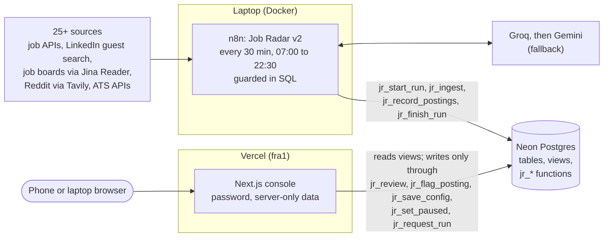

# Job Radar

A personal job-search pipeline that runs on a laptop for $0 a month. An n8n workflow pulls postings from 25+ sources, drops most of them with explainable rules, has an LLM check and score the rest, and writes everything to Postgres. A small Next.js console is where I review matches on my phone, see what the filters dropped and why, and change the search rules as versioned config.

**Why v2.** Version 1 (n8n + Google Sheets, [below](#v1)) went silent for six weeks without anyone noticing, never actually applied its own config (every run logged rev `v0`), and turned 500 to 600 postings a run into 0 to 2 matches with no way to see where the rest went. v2 rebuilds it around three ideas:

- **A funnel ledger.** Every posting the radar sees is stored with the stage and the rule that dropped it, plus the evidence. Nothing is filtered silently.
- **Explainable hard filters before the LLM.** Two deterministic gates drop on clear evidence for free; the LLM only re-checks and scores the best 40.
- **Config as data.** The search rules are one validated JSON document with revisions, edited in the console. Changing a rule is a new rev, and precision is measured per rev from my own verdicts.

## Architecture



- **n8n on the laptop** does all fetching and scoring. A schedule fires every 30 minutes, and `jr_should_run()` in Postgres decides whether a run is due (first run of the day, or a run requested from the phone, at most 3 a day). If the laptop was off at 07:00, the next tick catches up.
- **Neon Postgres** is the single source of truth: the funnel ledger, matches, runs, config revisions and an audit log. All rules that must hold (verdict state machine, config validation, budgets, dedupe) live in SQL functions, so neither n8n nor the console can bypass them.
- **The console** never writes to a table directly: it calls the `jr_*` functions, and shows their error messages verbatim.

## Sources

| Group | Sources | How |
|---|---|---|
| Job APIs and feeds (13) | Remotive, RemoteOK, Arbeitnow (visa flag), We Work Remotely (programming, sales and marketing), n8n Community jobs, Jobicy, HN Who is Hiring, Himalayas, RevOps Roles, Clay Community, Remocate (the 12 from v1), plus Working Nomads | Public JSON APIs and feeds |
| LinkedIn | 6 searches × 2 pages (remote worldwide and EU, plus hybrid and on-site with visa or relocation keywords) | Public guest endpoint, at most 20 requests a run; stops for the run on a 429 |
| Job boards | GTM Jobs (gtmjobs.xyz), GTM Jobs HQ, Uplift GTM, RevOps Careers, Cargo GTM job board, GTMfund portfolio jobs, startup.jobs (on); GTM Quest, Clay job board, adamgtm, Contra (off until their link patterns are confirmed) | One generic Jina Reader adapter. Each board is just `list_urls` + a `job_url_regex` in config, so a broken board is fixed from the console, not in code |
| Reddit | 15 subreddits (r/forhire, r/gtmengineering, r/n8n, ...), 6 queries | Tavily search with `include_domains: reddit.com`, since Reddit closed its self-serve API and is retiring RSS |
| ATS watchlist | 11 companies (Clay, n8n, Attio, Unify, lemlist, Apollo.io, Oyster, Wolt, NavVis, Forto, AUTO1 Group) | Public Greenhouse, Lever and Ashby job-board APIs |

Every source reports fetched, passed, new, matches and errors per run. The console's Sources screen turns that into a health dot per source, and a board whose regex stops matching shows `parser_no_links ... fix job_url_regex in the console` instead of failing quietly.

## The three gates

Deterministic gates drop only on clear evidence; the LLM gate is strict. Every drop stores the rule (`reason`) and the text that triggered it (`reason_detail`).

| Gate | Reads | Drops for |
|---|---|---|
| **A: metadata** | title, location, date, source flags | senior or blocked titles (Senior, Staff, SDR, AE...), not a target role, older than the freshness window, remote but region-locked (US only, ...), work mode switched off |
| **B: description** | the posting text (fetched through Jina or the LinkedIn guest API) | a stated minimum of years above `experience.max_years_required`, a blocked language or German/French/Dutch/Spanish job description, no visa signal for hybrid or on-site, "existing work authorization required", unpaid or commission-only offers |
| **C: LLM re-check** | the LLM's structured extraction | phrasings the regexes miss ("at least one year in RevOps is a must"), seniority, language, work mode, visa; then the weighted score must clear `scoring.min_score` |

A real drop from the ledger (`v_jr_dropped`, 2026-10-31, config rev `v2-004`):

| | |
|---|---|
| Posting | Full-Stack Developer, Fluence International (via Remotive) |
| Stage | `dropped_b` (gate B, description) |
| Reason | `experience_years`: "Requires more experience" |
| Evidence | `t we’re looking for 3+ years of experience as a full-stack or frontend-he` |
| Lever | `experience.max_years_required` (currently 0) |

The evidence is the matched phrase with 20 characters before it and 45 after, exactly as gate B stored it. In the same 14 days the most common reasons were senior titles (671 postings, gate A), not a target role (349), older than the window (331), and stated experience (54 at gate B, 17 more caught by the LLM at gate C). The Filtered screen shows these counts per reason with the config lever behind each, and every dropped posting has a "Should have passed" button, so false negatives are counted too.

Postings that miss the LLM cap or fail a fetch go back to the queue instead of being lost, and a new config rev re-evaluates earlier drops that are still listed: relaxing a rule brings those postings back.

## Config as versioned JSON

All search rules are one JSON document (`config/default_config_v2.json` is the seed): experience limits, work modes and visa phrases, role terms, blocked languages, opportunity types, freshness and LLM budget, scoring weights, the profile sent to the LLM, and every source.

- Stored append-only in `jr_config_versions`; the newest rev is active and every run records which rev it used.
- Validated twice: `jr_validate_config()` in SQL guards invariants and free-tier budgets (e.g. LinkedIn searches × pages ≤ 20, enabled board pages ≤ 30), and a zod mirror (`console/lib/config-schema.ts`) checks the full shape and compiles the JavaScript regexes before saving.
- Edited in the console as a form (one section per area, with limits read from the schema), as raw JSON, or by restoring an older rev. Every save needs a new rev and a note, and the Versions tab diffs any two revs.
- Measured: the Runs screen shows precision per rev from my verdicts (good fit vs not a fit), false positives per reason with the config key to change, and good vs not-a-fit counts per score bucket.

## The console

Next.js 16 (App Router, Cache Components), Tailwind 4 and shadcn/ui, `@neondatabase/serverless` over HTTP, on Vercel Hobby. One user behind a password (signed session cookie); every page and server action checks the session, robots and `noindex` keep it out of search engines, and there are no public API routes. Built 390 px first, because verdicts happen on a phone.

| Screen | What it is for |
|---|---|
| Today | New matches, best first, jobs and gigs, filters by work mode and source |
| Match | Why it matches, red flags, extracted attributes, score breakdown, verdicts (good fit, not a fit with a reason, applied, interviewing, offer, rejected), notes, history |
| Pipeline | Shortlist, applications in progress, closed, not a fit |
| Filtered | Last run funnel, drop reasons with their levers, every dropped posting with its evidence and a "Should have passed" flag |
| Sources | Health per source, and editors for LinkedIn searches, Reddit, ATS companies and boards |
| Config | The versioned config: form, Advanced JSON, Versions with diff and restore |
| Runs | Health, pause, request a run, the last 30 runs, calibration |

## Free-tier budget

| Service | Free allowance | Expected use |
|---|---|---|
| Neon compute | 100 CU-hours per project per month, scale to zero after 5 min | about 25 (30 guard ticks a day, one run, the console) |
| Neon storage | 1 GB per branch | well under 50 MB: no descriptions stored, unmatched postings purged after 45 days |
| Groq `openai/gpt-oss-120b` | 30 RPM, 1,000 RPD, 8K TPM, 200K TPD | 40 calls × about 1.8K tokens = about 72K tokens a day, paced 15 s apart |
| Gemini | free tier | fallback only |
| Tavily | 1,000 credits a month | 6 a day, about 180 a month |
| Jina Reader | 20 RPM per IP without a key | about 12 list pages and up to 40 detail pages a run, paced 3.5 s |
| LinkedIn guest | undocumented, about 1 request a second | up to 12 list and 40 detail requests a day |
| Vercel Hobby | personal, non-commercial | one project |
| n8n | self-hosted | Code-node task timeout raised to 1,800 s |

## Repo layout

```
sql/radar_v2_schema.sql        full Neon schema with the seed config; safe to re-run
sql/migrations/                changes applied to the live database since (run in date order)
config/                        default config and saved revs (v2-002, v2-004)
n8n/01..18_*.js                Code-node sources, one file per node of "Job Radar v2"
n8n/19_*.js, n8n/20_*.js       patched v1 nodes (RemoteOK mapper, RevOps Roles error branch)
n8n/90_probe.js                one-off probe used to discover board regexes and ATS tokens
n8n/workflows/                 workflow exports (v1 today; v2 export to follow)
tests/                         130 checks: schema, gates, detail budget, v1 patches, the full pipeline on PGlite, config schema
console/                       the Next.js console (deployed from this folder)
  lib/radar.ts                 every read (views and selects only)
  app/(console)/actions.ts     every write (calls a jr_* function)
  lib/config-schema.ts         zod mirror of jr_validate_config
  lib/reasons.ts               reason codes to plain words and their config levers
.env.example                   n8n host environment (names only)
```

## Setup

**1. Neon.** Create a project (the radar uses `aws-eu-central-1`, 0.25 CU, scale to zero). In the SQL Editor run `sql/radar_v2_schema.sql`; it creates the tables, views and functions and seeds config rev `v2-001`, and running it twice is safe. On a database created from an older copy of the schema, also run the files in `sql/migrations/` in date order.

**2. n8n.** Self-hosted n8n 2.x in Docker. Set the variables from `.env.example` on the n8n service (`N8N_RUNNERS_TASK_TIMEOUT=1800` matters: the default 300 s stops the LLM loop) and create two credentials: a Postgres credential for the Neon project (direct, not pooled, SSL required) and a header-auth credential for Tavily. The v2 workflow export will be added as `n8n/workflows/job-radar-v2.json`; import it and attach the credentials. Each Code node's source is also in `n8n/NN_*.js` under the node's name, so a node can be updated by pasting its file.

**3. Console.** In `console/`, copy `.env.example` to `.env.local` and set `DATABASE_URL` (Neon's pooled connection string), `DASHBOARD_PASSWORD` (16+ characters) and `SESSION_SECRET` (32+ random characters). Then:

```bash
npm install
```

```bash
npm run dev
```

On Vercel: import the repo with **Root Directory `console`**, set the same three variables for Production and Preview, and add an Ignored Build Step of `git diff --quiet HEAD^ HEAD -- .` so commits outside `console/` don't trigger a build. `vercel.json` pins the functions to `fra1`, next to the database.

**4. Tests.** No database or API keys needed: the schema and the whole pipeline run against PGlite (Postgres in WebAssembly) with recorded LinkedIn, Jina, Tavily, Ashby, Working Nomads and LLM payloads.

```bash
cd tests && npm install && npm test
```

## v1

The first version ran the same idea on n8n with Google Sheets as storage and a Discord digest: about 10 remote job boards, JavaScript hard filters, a Groq to Gemini fallback router and a weighted score. Its export is kept as [`n8n/workflows/job-radar-v1.json`](n8n/workflows/job-radar-v1.json). It worked, but it had no record of what it dropped, its config never reached the runs, and a dead run looked exactly like a quiet day, which is what v2 fixes.
